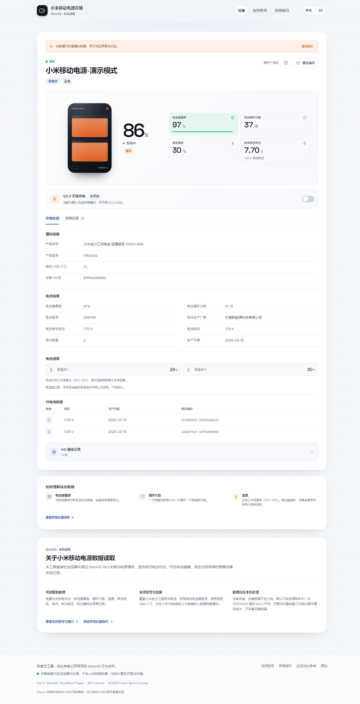

# Xiaomi Power Bank Console

一个用 **Vue 3 + TypeScript + WebHID** 重写的「小米移动电源详情」前端。项目从公开网页 [`powerbank.mieco.net`](https://powerbank.mieco.net/) 的 WebHID 行为逆向而来，可部署到 **Cloudflare Pages**，并附带一个无需真实设备的演示模式。

> 非官方工具，与小米公司无隶属关系。所有设备数据只在浏览器内解析，不会上传到服务器。



<sub>桌面端演示模式。移动端效果见 [mobile-demo.png](docs/images/mobile-demo.png)，支持型号页见 [models.png](docs/images/models.png)。</sub>

## 功能

- 通过 WebHID 连接小米移动电源（VID `0x2717` / `0x1A86`，产品名 `XiaomiPowerBank`）
- 读取并展示：
  - 产品名称、型号、SN
  - 当前电量、充放电状态
  - 电池健康度、循环次数、电池温度、串总电压、电流
  - 电芯数量、单节电芯电压、生产日期、电芯编码
  - 电池温度阈值与电池型号（支持的型号）
  - 本地异常记录（按时间倒序、分页）
- Qi2.2 无线充电开关（仅小米金沙江充电宝 超薄磁吸 10000 45W / `WPB1025S`、`WPB1026S`）
- 15 秒 Hello 心跳保活，连接期间保持屏幕唤醒
- 内置演示数据，没有硬件也能完整体验界面
- 中 / 英双语，自动检测系统语言，可手动切换并记忆
- HID 通信记录查看器，可核对原始帧、CRC 和收发方向
- 支持型号表与异常处理指引
- 纯静态构建，无后端、无遥测、无第三方分析脚本

## 浏览器要求

| 浏览器                       | 支持情况         |
| ---------------------------- | ---------------- |
| 桌面版 Chrome / Edge / Opera | ✅ 支持          |
| 桌面版 Chromium 内核浏览器   | ✅ 通常支持      |
| Firefox / Safari             | ❌ 不支持 WebHID |
| Android / iOS 浏览器         | ❌ 不支持 WebHID |

必须在 **HTTPS**（或 `localhost`）下打开页面。连接操作必须由用户点击触发。

## 本地开发

要求 Node.js 22+。

```bash
npm install
npm run dev
```

打开终端提示的本地地址，使用桌面版 Chrome / Edge / Opera。点击「建立连接」，在浏览器弹窗中选择 `XiaomiPowerBank`。

### 连接真实设备

1. 使用支持数据传输的 USB-C 线，把移动电源的「指定 USB-C 口」连到电脑。具体接口见 `/models` 页面。
2. 在 4 秒内连续快速按 8 次移动电源按键，进入数据传输模式。
3. 点击页面上的「建立连接」，在浏览器配对弹窗中选择 `XiaomiPowerBank`。
4. 首次握手成功后，页面会读取电池信息、电芯状态和电芯编码。

> 不同型号的指定接口不同；部分型号会隐藏 SN 或只提供第一个测温点，这些行为已在代码中处理。

## 构建与部署

```bash
npm run typecheck
npm test
npm run build
```

构建产物在 `dist/`。

### Cloudflare Pages（推荐）

在 Cloudflare Dashboard 的 Pages 中连接 Git 仓库：

- Framework preset：`Vite`
- Build command：`npm run build`
- Build output directory：`dist`
- Node version：`22`（仓库内的 `.nvmrc` 已声明）

仓库已包含：

- `public/_redirects`：SPA history 路由回退到 `index.html`
- `public/_headers`：基础安全响应头与静态资源缓存
- `wrangler.toml`：`pages_build_output_dir = "dist"`

也可以使用 Wrangler 直接发布：

```bash
npx wrangler login
npm run deploy
```

`npm run deploy` 会执行构建并调用：

```bash
wrangler pages deploy dist --project-name xiaomi-powerbank-console
```

### GitHub Actions

`.github/workflows/deploy.yml` 会在推送 `main` 时构建并发布到 Cloudflare Pages。需要在仓库 Secrets 中配置：

- `CLOUDFLARE_API_TOKEN`
- `CLOUDFLARE_ACCOUNT_ID`

## 项目结构

```text
.
├─ docs/
│  ├─ REVERSE_ENGINEERING.md      # 逆向记录、协议表、来源与已知限制
│  └─ images/                     # README 截图
├─ public/
│  ├─ _headers                    # Cloudflare Pages 响应头
│  ├─ _redirects                  # SPA 路由回退
│  ├─ favicon.svg
│  └─ robots.txt
├─ src/
│  ├─ assets/styles/              # 设计 token 与基础样式
│  ├─ components/                 # 连接卡片、设备面板、电芯表、协议日志等
│  ├─ composables/                # i18n、toast
│  ├─ data/
│  │  ├─ models.ts                # 支持型号表
│  │  ├─ batteryIdMaps.ts         # 电芯编码/厂商/小米项目映射
│  │  └─ i18n/                    # 中英文文案
│  ├─ lib/
│  │  ├─ hid/                     # WebHID / 模拟传输层、设备客户端
│  │  └─ protocol/                # CRC、帧、解码器、格式化
│  ├─ router/
│  ├─ stores/device.ts            # Pinia 设备状态与会话流程
│  ├─ tests/                      # Vitest 协议与模拟设备测试
│  ├─ types/
│  └─ views/                      # 设备页、支持型号、异常指引
├─ index.html
├─ vite.config.ts
├─ wrangler.toml
└─ package.json
```

## 协议摘要

完整说明见 [`docs/REVERSE_ENGINEERING.md`](docs/REVERSE_ENGINEERING.md)。

- 32 字节 HID 报告，`reportId = 0`
- 通用帧：`A5 | CMD | LEN | PAYLOAD | CRC8`，不足 32 字节补零
- CRC：CRC-8/ATM，多项式 `0x07`，初值 `0x00`
- 握手：特殊 `Hello` 帧，包含北京时间戳和 `xiaomi-pb` magic
- 主要响应：`0x10` Hello、`0x11` 电池信息、`0x12` 电芯状态、`0x13` 异常记录、`0x14` 电芯编码、`0x18` 温度阈值/型号
- 心跳：每 15 秒重发一次 Hello 帧

## 演示模式

没有移动电源时，点击「查看演示数据」会使用 `MockTransport` 模拟：

- 2 节电芯
- 86% 电量、97% 健康度、37 次循环
- 两个温度传感器
- 可切换的 Qi2.2 状态
- 三条历史异常记录
- 模拟的原始 HID 帧与协议日志

演示模式不会访问任何真实 HID 设备，适合检查 UI 和 Cloudflare Pages 部署。

## 测试

```bash
npm test          # Vitest：CRC、帧解析、解码器、模拟设备会话
npm run typecheck # vue-tsc
```

测试覆盖：

- CRC-8 计算
- Hello / 命令帧构造与零填充
- 多帧输入报告提取与不完整帧保留
- 电池信息、电芯状态、电芯编码、温度阈值、历史记录、Qi2.2 状态/开关解码
- 使用模拟传输层完成握手 → 电池信息 → 电芯 → 编码 → 温度 → Qi2.2 → 历史 → 断开的完整流程

## 隐私与安全

- 没有后端 API，没有网络请求、遥测或第三方脚本
- 不写入固件、不修改电池参数；默认只发送读取类命令和断开命令
- 仅对 `WPB1025S` / `WPB1026S` 提供带二次确认的 Qi2.2 开关，其他型号不会显示写入控件
- 页面不提供任意原始命令输入，避免误操作
- WebHID 访问需要显式用户手势与浏览器授权

## 参考与致谢

- 原始页面：[powerbank.mieco.net](https://powerbank.mieco.net/)
- 协议参考（Python HID 工具，MIT）：[yomiel-s/xiaomi-powerbank-tools](https://github.com/yomiel-s/xiaomi-powerbank-tools)
- WebHID 规范：[WICG/webhid](https://github.com/WICG/webhid)
- UI 参考（未复用代码）：[xingrz/ChargeMon](https://github.com/xingrz/ChargeMon)、[Smart-financial-class/PowerMonitor](https://github.com/Smart-financial-class/PowerMonitor)

本项目为独立重写。原始页面的 React 代码、图片资源和品牌素材未复制到仓库；电芯编码表、型号表和界面文案仅用于设备互操作与信息展示。

## License

MIT。详见 [LICENSE](LICENSE)。

Xiaomi 及相关名称为小米公司的商标。本项目与小米公司无隶属关系，也不代表其官方立场。
